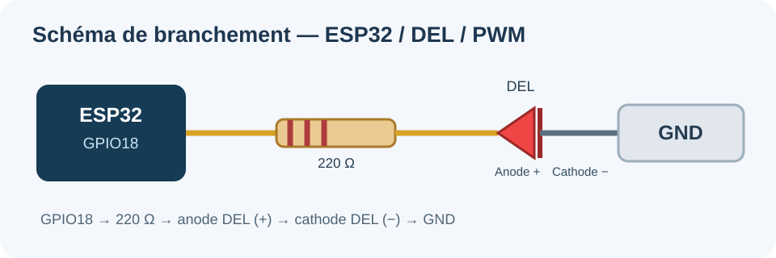

# ESP32 PWM Web Control

> Projet IoT — Contrôle à distance de la luminosité d'une DEL via une interface web hébergée sur un ESP32.

**Arduino ESP32 3.x** · **C++** · **Wi-Fi local** · **PWM 5 kHz / 8 bits** · **GPIO18**

## Présentation

L'ESP32 héberge un serveur HTTP local sur le port 80. Depuis un ordinateur ou un téléphone connecté au même réseau Wi-Fi, on peut régler la luminosité de la DEL avec **sept boutons** : 0 %, 25 %, 50 %, 75 %, 100 %, −10 % et +10 %.

La page indique le **rapport cyclique**, la **valeur PWM sur 255** et la **tension moyenne estimée**. Le firmware rejette les requêtes invalides sans changer la luminosité et tente de se reconnecter au Wi-Fi si la connexion tombe.

**Projet réalisé pour le cours 420-PC6-AG — Programmation d'objets connectés, Institut Grasset.**

## Matériel et branchements

- ESP32 Dev Module
- DEL et résistance de **220 Ω**
- Plaque d'essai, fils Dupont et câble USB

**Branchement :** ESP32 **GPIO18 → résistance 220 Ω → anode (+) DEL → cathode (−) → GND**.

Débrancher l'USB avant de modifier les branchements.

## Installation

1. Installer [Arduino IDE](https://www.arduino.cc/en/software/) et le paquet **esp32 by Espressif Systems 3.x**.
2. Ouvrir [firmware/Controle_LED_ESP32/Controle_LED_ESP32.ino](firmware/Controle_LED_ESP32/Controle_LED_ESP32.ino).
3. Copier **config.example.h** vers **config.h** dans le même dossier, puis ajouter les identifiants de votre Wi-Fi 2,4 GHz.
4. Sélectionner **ESP32 Dev Module**, le bon port COM, puis téléverser.
5. Ouvrir le moniteur série à **115200 bauds** et relever l'adresse IP.
6. Depuis un appareil sur le même réseau, ouvrir **http://ADRESSE_IP/**.

> 🔒 Le fichier `config.h` et les identifiants Wi-Fi ne sont **jamais** inclus dans le dépôt.

## Principes techniques

- **Fréquence PWM :** 5 000 Hz.
- **Résolution :** 8 bits, soit 256 niveaux (0 à 255).
- **Conversion :** `PWM = arrondi(pourcentage × 255 / 100)`.
- **Tension moyenne estimée :** `V ≈ (pourcentage / 100) × 3,3 V`.
- **Courant théorique de la DEL :** `I = (3,3 − 2,0) / 220 ≈ 5,9 mA`.

| Luminosité | Valeur PWM | Tension moyenne estimée |
|---|---:|---:|
| 0 % | 0 | 0,00 V |
| 25 % | 64 | 0,83 V |
| 50 % | 128 | 1,65 V |
| 75 % | 191 | 2,48 V |
| 100 % | 255 | 3,30 V |

## API HTTP

| Route | Description |
|---|---|
| `GET /` | Affiche la page et l'état courant |
| `GET /pwm?duty=N` | Règle la luminosité entre 0 et 100 % |
| `GET /plus` | Ajoute 10 points, sans dépasser 100 % |
| `GET /moins` | Retire 10 points, sans descendre sous 0 % |
| Paramètre invalide | **HTTP 400**, luminosité inchangée |
| Route inconnue | **HTTP 404** |

## Fichiers du projet

- [Code Arduino](firmware/Controle_LED_ESP32/Controle_LED_ESP32.ino)
- [Configuration exemple](firmware/Controle_LED_ESP32/config.example.h)
- [Documentation technique](docs/rapport-technique.md)
- [Plan de tests](docs/tests.md)
- [Schéma électrique](docs/schema-branchement.svg)

La page fonctionne **sur le réseau local**, sans service cloud. N'exposez pas ce serveur directement à Internet : aucune authentification utilisateur n'est prévue.

## Tests et validation

Les commandes PWM, les boutons web et les réponses HTTP ont été vérifiés pendant la réalisation du TP. Voir [docs/tests.md](docs/tests.md) pour le protocole complet. Le mécanisme de reconnexion Wi-Fi est implémenté ; il doit être testé sur le matériel après toute modification.

---

**Auteur : motbravea** · Projet pédagogique en français.
