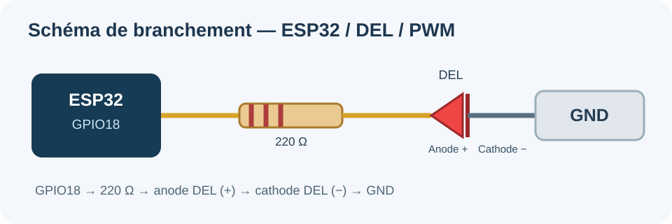

# Rapport technique — Contrôle de la luminosité d'une DEL par PWM et serveur web ESP32

**Institut Grasset · Programmation d'objets connectés · TP du 11 novembre 2026**  
**Plateforme :** ESP32 Dev Module · Arduino IDE · Arduino-ESP32 3.x

## 1. Objectif du projet

Créer un objet connecté dont la DEL se règle à distance depuis une page web hébergée directement sur l'ESP32. La page fonctionne sur le réseau local et présente sept boutons : **0 %, 25 %, 50 %, 75 %, 100 %, −10 % et +10 %**. Le navigateur reçoit après chaque action le pourcentage de luminosité, la valeur PWM utilisée et une estimation de la tension moyenne.

## 2. Matériel et branchement

| Élément | Fonction |
|---|---|
| ESP32 | Wi-Fi, traitement HTTP et génération du signal PWM |
| GPIO18 | Sortie PWM |
| Résistance 220 Ω | Limite le courant dans la DEL |
| DEL | Émet de la lumière selon le rapport cyclique |
| Breadboard + fils | Interconnexion et prototype |
| Ordinateur/téléphone | Client HTTP sur le même réseau |



**Circuit :** GPIO18 → résistance de 220 Ω → anode de la DEL → cathode → GND.

**Calcul du courant théorique :** en prenant une chute de tension de 2,0 V aux bornes de la DEL :

```text
I = (3,3 V − 2,0 V) / 220 Ω = 0,00591 A ≈ 5,9 mA
```

Cette valeur est une estimation dépendant du type de DEL et de sa tension directe.

## 3. PWM : fréquence et résolution

Le PWM (*Pulse Width Modulation*) permet de moduler la luminosité en alternant très rapidement les états HIGH et LOW.

- Fréquence : **5 000 Hz** (5 kHz).
- Résolution : **8 bits**, soit 256 niveaux (0 à 255).
- Configuration Arduino-ESP32 3.x : `ledcAttach(18, 5000, 8);`.
- Application : `ledcWrite(18, valeur);`.

À titre de justification, la formule simplifiée indiquée dans le sujet donne :

```text
f_max = 80 000 000 / 2^8 = 312 500 Hz > 5 000 Hz
valeur_PWM = arrondi(pourcentage × 255 / 100)
tension_moyenne ≈ pourcentage × 3,3 / 100
```

| Consigne | PWM | Tension moyenne estimée |
|---|---:|---:|
| 0 % | 0 | 0,00 V |
| 25 % | 64 | 0,83 V |
| 50 % | 128 | 1,65 V |
| 75 % | 191 | 2,48 V |
| 100 % | 255 | 3,30 V |

La tension moyenne est calculée et **n'est pas une mesure directe** réalisée avec un voltmètre.

## 4. Serveur HTTP et traitement des requêtes

L'ESP32 se connecte au Wi-Fi, démarre `WebServer server(80)` et retourne une page HTML intégrée au firmware. Les boutons correspondent à ces routes :

| HTTP GET | Action |
|---|---|
| `/` | État courant et page HTML |
| `/pwm?duty=N` | Règle un entier entre 0 et 100 % |
| `/plus` | Ajoute 10 points, maximum 100 % |
| `/moins` | Retire 10 points, minimum 0 % |
| Autre route | Réponse HTTP 404 |

**Exemple :** `GET /pwm?duty=40` → `round(0,40 × 255) = 102` ; tension moyenne ≈ **1,32 V**.

Les paramètres absents, non numériques ou hors de 0–100 produisent **HTTP 400** et la DEL conserve sa valeur. Le moniteur série journalise la route, le pourcentage et la valeur PWM.

### Cheminement logiciel

```text
Démarrage → configuration PWM → Wi-Fi → serveur HTTP
                                          ↓
                          Réception d'une requête GET
                                          ↓
                              Validation du paramètre
                                /                   \
                         invalide                  valide
                           ↓                         ↓
                    HTTP 400, DEL             Conversion 0..255
                      inchangée                      ↓
                                              ledcWrite(GPIO18)
                                                    ↓
                                           HTML avec nouvel état
```

La boucle principale appelle `server.handleClient()` sans `delay()` bloquant. Une vérification périodique du statut Wi-Fi tente une reconnexion toutes les dix secondes si nécessaire, sans remettre la luminosité à zéro.

## 5. Essais et résultats

Le montage a été testé avec la DEL sur GPIO18 et le serveur HTTP accessible depuis un navigateur local. Les essais de réglage 0, 25, 50, 75, 100 %, les commandes ±10 % et les réponses aux requêtes invalides ont été réalisés au cours du projet.

Les commandes ±10 % ont été observées dans le moniteur série ; les valeurs PWM obtenues concordent avec les calculs (ex. **60 % → 153/255**).

Voir [plan de tests](tests.md) pour les actions reproductibles et les cas limites. La simulation d'une panne réseau prolongée doit être confirmée sur la carte avant d'affirmer que la reconnexion a été entièrement testée.

## 6. Difficultés et solutions

- **Installation du paquet ESP32 :** erreur 504 (timeout) lors du téléchargement ; installation relancée avec succès.
- **Téléversement :** erreur de mode BOOT `0x13` ; utilisation du bouton BOOT au moment du téléversement.
- **Port série :** absence de port sélectionné ; correction en choisissant le bon COM.
- **Réseau :** usage d'un point d'accès compatible et de l'adresse IP affichée par l'ESP32.

## 7. Conclusion

Le TP démontre une commande PWM depuis une page web embarquée : conversion des consignes en valeurs 8 bits, variation de l'intensité de la DEL, traitement des requêtes HTTP et gestion des erreurs. L'application est adaptée à un **réseau local de démonstration** et ne comporte pas d'authentification pour une exposition publique.

**Sources techniques :** consignes du TP de l'Institut Grasset ; documentation Arduino-ESP32 (LEDC, WiFi, WebServer). Les informations personnelles de connexion Wi-Fi sont conservées uniquement dans le fichier privé `config.h`.
